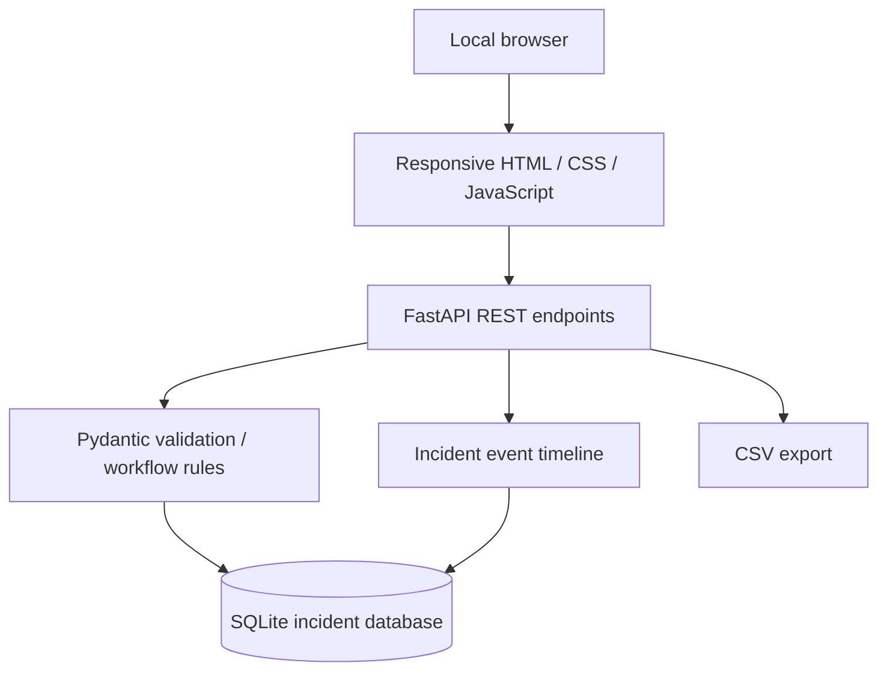

# Incident Management Dashboard

[](https://github.com/KamranAbbasiDEV/Incident-Management-Dashboard/actions/workflows/ci.yml)

A **full-stack incident tracking and triage dashboard** built with **Python, FastAPI, SQLite, HTML, CSS and vanilla JavaScript**. Designed as a cloud-support engineering portfolio lab for learning incident lifecycles, severity classification, escalation notes and service reliability reporting.

> **Scope:** Local, single-user educational project. There is **no authentication**. Use synthetic data only; never put it on a public server or store real customer incidents.

## Features

- Modern responsive dark-mode operations dashboard, suitable for desktop or mobile.
- Create incidents with service, priority, description and owner.
- Manage lifecycle: **Open → Investigating → Mitigated → Resolved**. Supports direct Open → Resolved and reopening Resolved → Investigating; invalid transitions receive HTTP 409.
- Search incidents by title, service and owner, plus status and priority filters.
- Activity timeline for status changes and operator investigation notes.
- Summary cards for total, active and resolved incidents and mean time to resolve (**MTTR**).
- Severity breakdown for P1 critical through P4 low.
- Export incident summaries as CSV, with protection against leading spreadsheet formulas.
- SQLite data persistence and parameterized queries.
- Interactive API documentation via FastAPI at `/docs`.
- Synthetic sample incident generator and isolated automated API tests.
- GitHub Actions CI for Python 3.11, 3.12 and 3.13.
- Optional Docker build and local-only container run.

## Run locally

Requirements: Python **3.11 or newer**. No AWS account, cloud credentials or paid services required.

```bash
git clone https://github.com/KamranAbbasiDEV/Incident-Management-Dashboard.git
cd Incident-Management-Dashboard

python -m venv .venv
# Linux or macOS:
source .venv/bin/activate
# Windows PowerShell:
# .venv\Scripts\Activate.ps1

python -m pip install -e ".[dev]"
python -m app.seed_demo
uvicorn app.main:app --host 127.0.0.1 --port 8000
```

Open **http://127.0.0.1:8000** in your browser.

The seed command inserts **eight synthetic incidents** into an empty database and does nothing if the database already contains incident records. It's safe to rerun on a previously populated demo.

To start with an empty dashboard, skip `python -m app.seed_demo`. A local SQLite database named `incident_dashboard.db` is created automatically and ignored by Git. To relocate it, set `INCIDENT_DB_PATH` to a writable path before startup.

## Dashboard layout

| Section | What it shows |
| --- | --- |
| Summary cards | Total incidents, active incidents, resolved incidents, mean resolution time |
| Status distribution | Proportions of open, investigating, mitigated and resolved |
| Severity overview | P1 critical, P2 high, P3 medium, P4 low counts |
| Incident queue | Search, filters, owners, priorities and created dates |
| Incident detail | Editable service, severity, status and owner; audit timeline and notes |

A user can create an incident, investigate it, add notes, update priority, resolve it, and export the resulting queue. Timelines reflect application actions and are **not tamper-proof audit logs**.

## REST API

| Method | Endpoint | Purpose |
| --- | --- | --- |
| GET | `/` | Interactive dashboard |
| GET | `/api/health` | Local health probe |
| GET | `/api/metrics` | Summary counts and resolution time |
| GET | `/api/incidents` | List/filter; query params `q`, `severity`, `status`, `limit` |
| POST | `/api/incidents` | Create incident |
| GET | `/api/incidents/{id}` | Get incident |
| PATCH | `/api/incidents/{id}` | Change status, severity, owner or details |
| GET | `/api/incidents/{id}/events` | Timeline |
| POST | `/api/incidents/{id}/notes` | Add timeline note |
| GET | `/api/export.csv` | Download incident summary |

**Example: create an incident** (run only against your local server):

```bash
curl -X POST http://127.0.0.1:8000/api/incidents \
  -H "Content-Type: application/json" \
  -d '{"title":"Synthetic API outage","service":"Customer API","severity":"P1","owner":"Cloud Support","description":"Educational scenario, no customer data."}'
```

**Example: filter active critical incidents:**

```bash
curl "http://127.0.0.1:8000/api/incidents?severity=P1&status=investigating"
```

## Run tests

```bash
python -m pytest -q
```

Tests use an isolated temporary SQLite database per test. They verify CRUD workflows, input validation, status transitions and reopening, notes, incident timeline, metrics, CSV safety, filtering and idempotent demo seeding. No network or AWS account is required.

GitHub Actions installs the package and runs these tests on three Python versions automatically.

## Run with Docker (optional)

```bash
docker build -t incident-dashboard .
docker run --rm -p 127.0.0.1:8000:8000 -v incident-data:/data incident-dashboard
```

Open http://127.0.0.1:8000. The named volume preserves SQLite data across container runs. The host-side `127.0.0.1:` binding is important: the application has no sign-in or authorization. The Docker image runs as an unprivileged user.

To add demo incidents to an *existing* container, use `docker exec <container-id> python -m app.seed_demo` after starting it.

## Architecture



See [architecture details](docs/ARCHITECTURE.md) and the [incident response training runbook](docs/INCIDENT_RUNBOOK.md).

## Security limitations

**Not production-ready.** The app lacks login, access controls, rate limiting, monitoring, retention policies, encryption at rest, central logging, migrations and multi-user coordination. Do not expose it to the internet or connect it to customer environments. The synthetic data generator does not pull actual incidents from any provider. See [SECURITY.md](SECURITY.md).

## Portfolio discussion prompts

- Why use incident severity versus lifecycle status?
- How does a P1 critical incident affect escalation and communications?
- Why are invalid status transitions rejected?
- How do database transactions preserve consistency between status updates and timeline events?
- How is MTTR calculated, and when could it be misleading?
- Why do production ITSM tools need RBAC and immutable audit logs?

MIT licensed — see [LICENSE](LICENSE).
