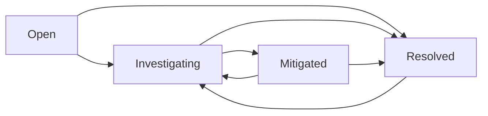

# Architecture & Design Notes

## Components

- **Browser UI:** Responsive vanilla JavaScript renders incident records and receives updates through REST requests. Server-provided text is rendered as text, not HTML.
- **FastAPI:** Defines typed request models, validates fields, enforces incident status transitions, and serializes JSON.
- **SQLite:** Persists incidents and append-only event entries with foreign-key constraints. Queries use bound parameters and update operations run in transactions.
- **Synthetic seed:** Creates eight fictional incidents only when the database is empty. No customer records are loaded.
- **GitHub Actions:** Runs isolated tests; does not deploy to AWS, a cloud service, or a public URL.

## Data model

```text
incidents
  id: integer primary key
  title: text
  description: text
  service: text
  severity: P1 | P2 | P3 | P4
  status: open | investigating | mitigated | resolved
  owner: text
  created_at: UTC ISO 8601
  updated_at: UTC ISO 8601
  resolved_at: UTC ISO 8601 | null

incident_events
  id: integer primary key
  incident_id: foreign key -> incidents.id
  event_type: created | updated | note
  detail: text
  created_at: UTC ISO 8601
```

## Lifecycle



Updates to resolved incidents can reopen them as **Investigating**. The `resolved_at` time resets on reopening. Mean time to resolve uses elapsed hours from incident creation to its latest resolution and is only a lightweight demonstration metric.

## Error semantics

- 201: incident or timeline note created.
- 400: empty PATCH request.
- 404: missing incident.
- 409: prohibited lifecycle transition.
- 422: invalid field value, missing field, or null where not permitted.

## Production work that has not been implemented

User authentication and RBAC, strong audit integrity, multi-tenant isolation, database backups, formal migrations, pagination beyond a configurable first page, activity correlation, production observability, real incident notification and paging integrations, and data retention controls.

The project should be presented as an educational local dashboard rather than as an enterprise-ready ITSM system.
